<div align="center">

# Forge Growth

**Self-hosted Instagram and WhatsApp automation, with the sales CRM behind it.**

Comment-to-DM automations and AI agents for Instagram · a visual flow builder, AI agents and
approved templates for WhatsApp · the contacts, funnel and follow-ups that turn those
conversations into sales — one app, on your own server.

[](https://github.com/Forgemind-git/ForgeGrowth-OSS/releases/latest)
[](./LICENSE)
[](https://github.com/Forgemind-git/ForgeGrowth-OSS/actions/workflows/ci.yml)

**MIT licensed · self-hosted · single-tenant · no SaaS tier · no telemetry**

Want it customised for your business? [Talk to Forgemind](#want-it-customised) — [WhatsApp](https://wa.me/919342245724?text=Hi%20Forgemind%21%20I%27m%20using%20Forge%20Growth%20and%20I%27d%20like%20to%20customise%20it%20for%20my%20business.%20Can%20we%20talk%3F) · [contact@forgemind.in](mailto:contact@forgemind.in?subject=Customising%20Forge%20Growth&body=Hi%20Forgemind%20team%2C%0A%0AI%27m%20using%20the%20open-source%20Forge%20Growth%20and%20I%27d%20like%20to%20customise%20it%20for%20my%20business.%0A%0AWhat%20I%27m%20looking%20for%3A%0A%0A%0AThanks%2C%0A)

</div>

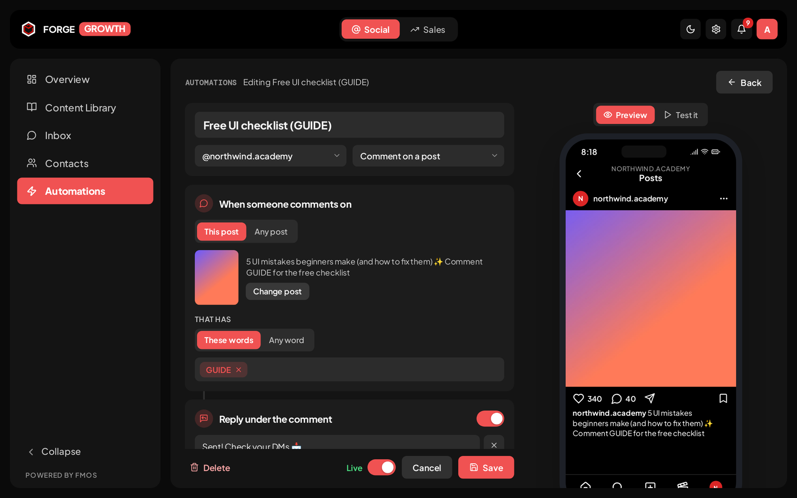

---

## Instagram

Everything for an Instagram business account, from the numbers to the automations that answer
people for you. It sits under the **Social** tab.

| | |
|---|---|
| **DM automations** | Comment-to-DM, DM keywords, story replies and mentions. Reply under the comment, open with a "tap to get it" message, gate on a follow, send a link card, collect name/email/phone into a Google Sheet, and follow up once if they don't tap — all built step by step with a live phone preview and a **Test it** simulator. |
| **AI agents** | An agent that answers DMs and/or comments for one account, from a prompt, with a hand-off to a person. |
| **Overview** | Followers, reach, engagement and top posts over 7, 30 or 90 days. |
| **Content library** | Every synced post and reel with its numbers and a content score; media in one place. |
| **Inbox & contacts** | DMs and comments in one inbox, and the contacts they came from. |

<table>
<tr>
<td width="50%">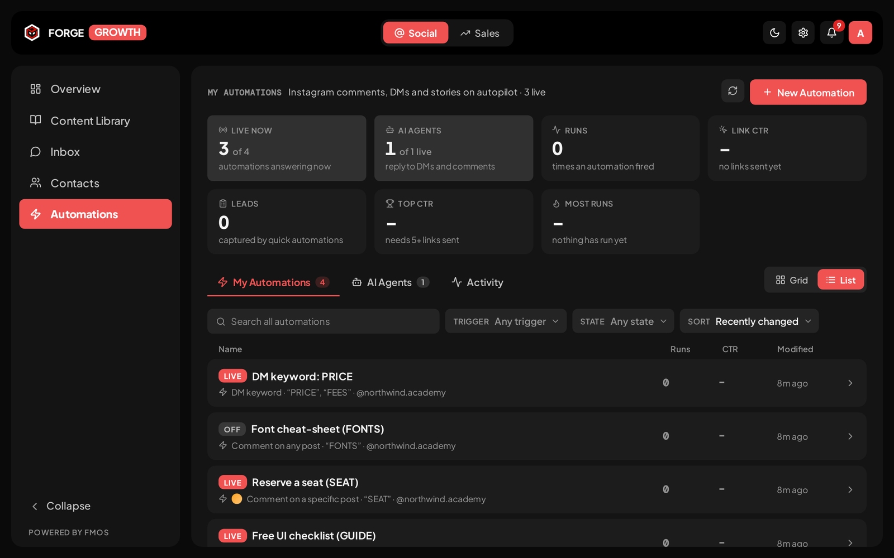</td>
<td width="50%">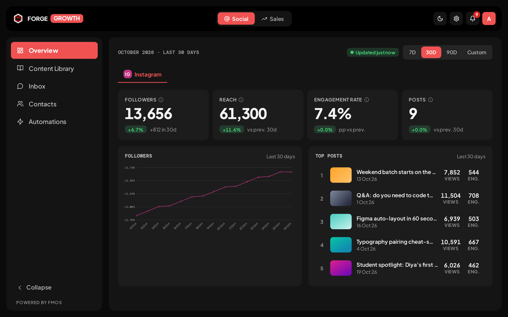</td>
</tr>
<tr>
<td><sub><b>Automations</b> — live status, runs and link CTR per rule</sub></td>
<td><sub><b>Overview</b> — the account at a glance</sub></td>
</tr>
<tr>
<td width="50%">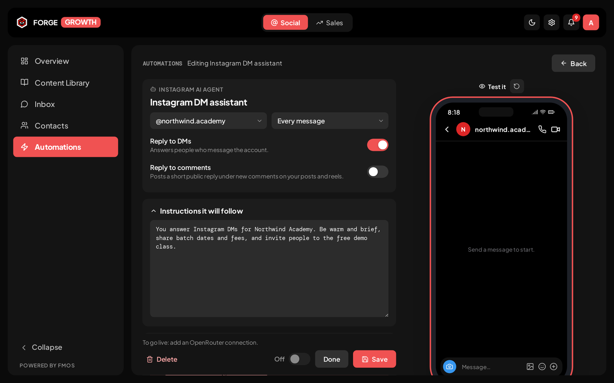</td>
<td width="50%">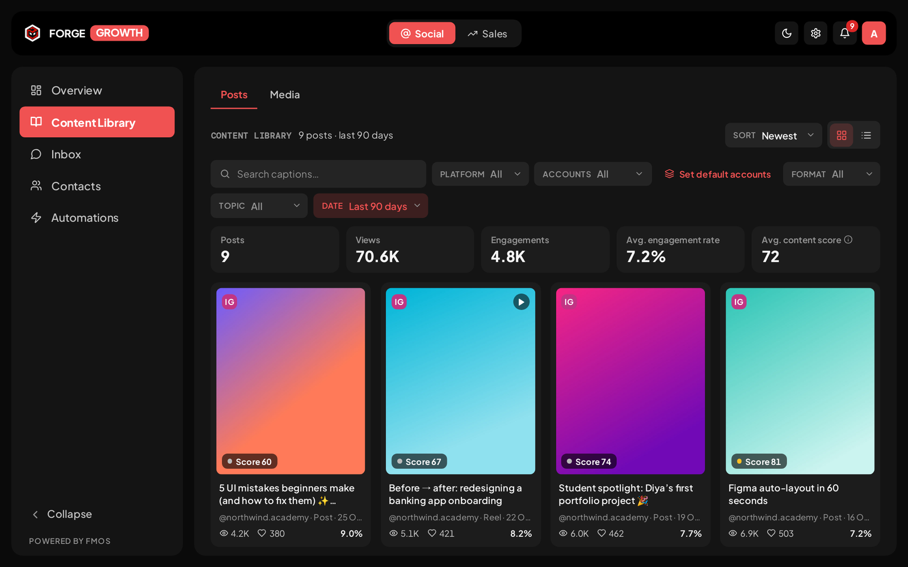</td>
</tr>
<tr>
<td><sub><b>AI agent</b> — answers DMs and comments, testable before it goes live</sub></td>
<td><sub><b>Content library</b> — synced posts with views, engagement and score</sub></td>
</tr>
</table>

---

## WhatsApp

Built on Meta's WhatsApp Cloud API, on your own WhatsApp Business number.

| | |
|---|---|
| **Flow builder** | A visual, left-to-right automation canvas: keyword, new-contact, any-message and tag triggers; messages with buttons and lists; conditions, actions, delays. Every branch is a visibly wired row, and a flow is checked before it can go live. |
| **AI agents** | A no-code agent per number — prompt, model, tools (Google Sheets, HTTP, media, CRM write-back), memory, human hand-off, voice-note transcription and spend limits — with a live test chat. |
| **Templates** | The full Meta lifecycle in a step-by-step builder with a phone preview: submit, sync, quality score, carousels, edit history. |
| **Chats** | A three-pane WhatsApp inbox with the 24-hour window enforced, media, and voice notes that arrive as real WhatsApp voice notes (and play on iPhone). |
| **Broadcasts & media** | Send now, once later or on a repeat, filtered by stage and tag; one media library synced to Meta; what every send actually costs. |

<table>
<tr>
<td width="50%">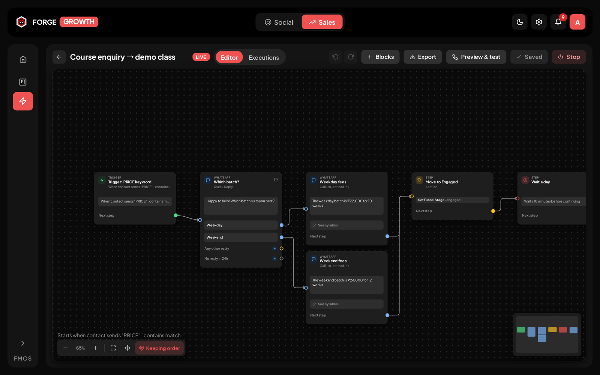</td>
<td width="50%">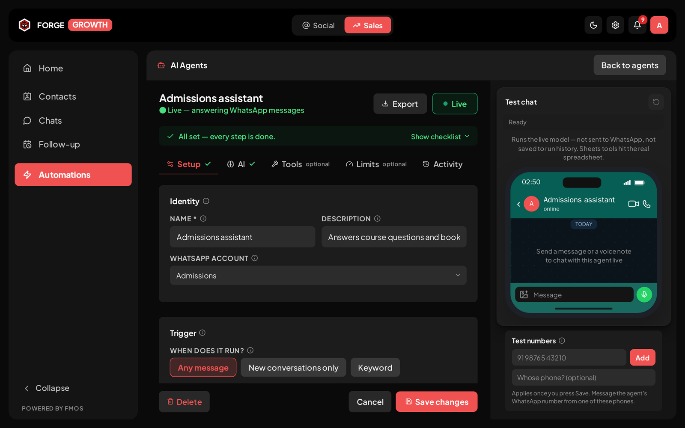</td>
</tr>
<tr>
<td><sub><b>Flow builder</b> — every reply button is its own wired branch</sub></td>
<td><sub><b>AI agent builder</b> — setup, model, tools and limits, with a live test chat</sub></td>
</tr>
<tr>
<td width="50%">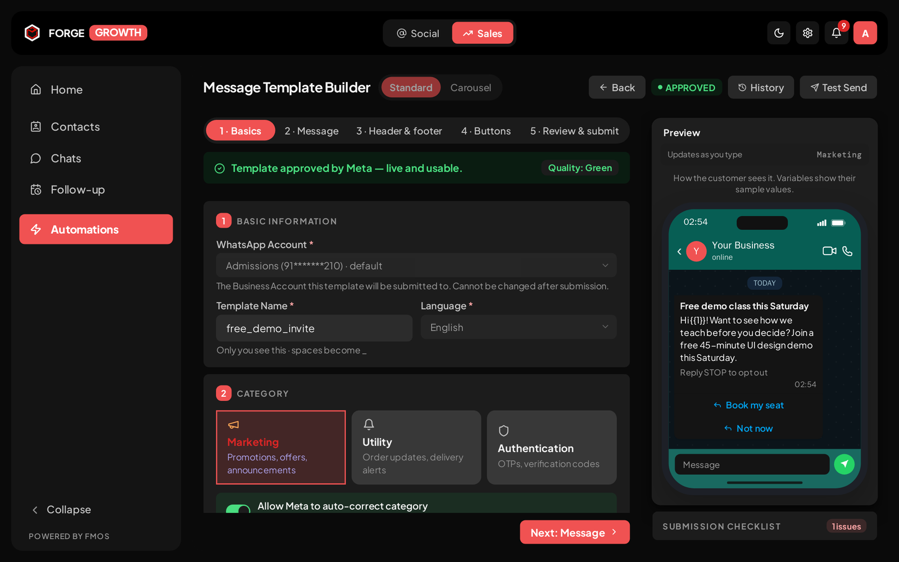</td>
<td width="50%">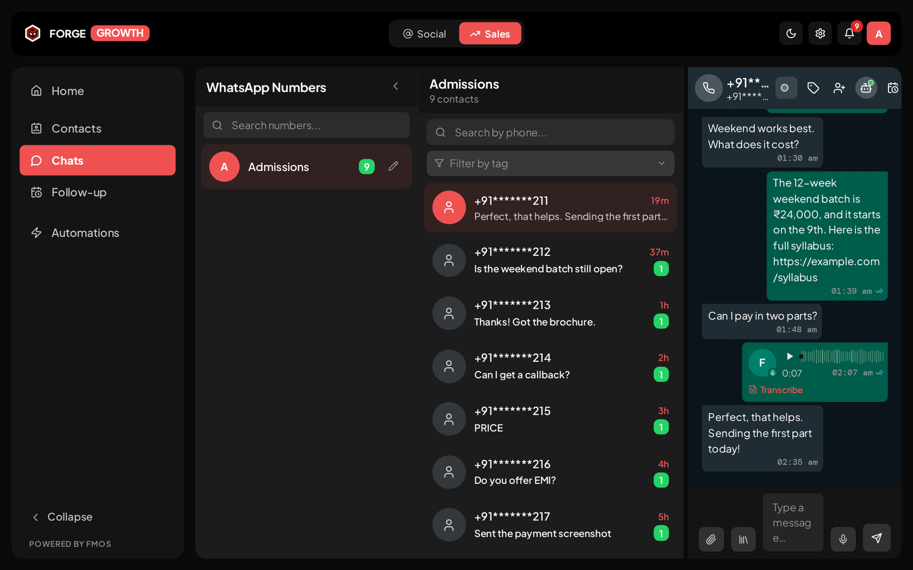</td>
</tr>
<tr>
<td><sub><b>Template builder</b> — five steps, previewed as the customer sees it</sub></td>
<td><sub><b>Chats</b> — the inbox, voice notes included</sub></td>
</tr>
</table>

---

## Sales

The conversations above become contacts, and contacts move through your funnel to a sale.

| | |
|---|---|
| **Home** | Came in → reached out → replied → won → paid, for 7, 30 or 90 days, plus where leads came from. |
| **Contacts & funnel** | One contact model with a funnel view, a table and a board; your own stages, tags and fields; CSV/XLSX import. |
| **Follow-up calendar** | Pin a lead's chat and give it a date — or let AI suggest one. A month calendar with today's and overdue follow-ups, drag to reschedule, optional Google Calendar sync. |
| **Sales** | A sale is a lead in a won stage; payments and refunds are recorded against it by hand. |

<table>
<tr>
<td width="50%">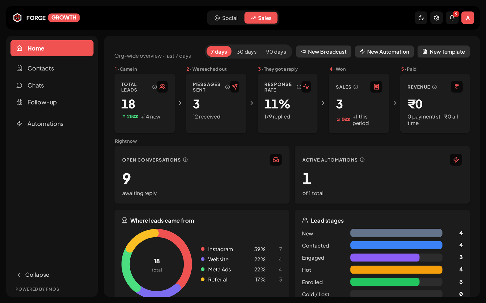</td>
<td width="50%">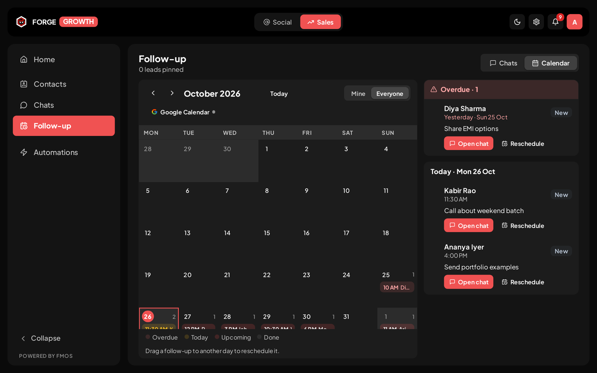</td>
</tr>
<tr>
<td><sub><b>Home</b> — the whole funnel for the period</sub></td>
<td><sub><b>Follow-up calendar</b> — who is due today, and who is overdue</sub></td>
</tr>
<tr>
<td colspan="2">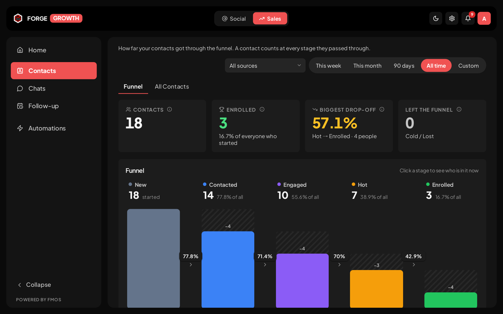</td>
</tr>
<tr>
<td colspan="2"><sub><b>Contacts</b> — how far people got, and where they dropped off</sub></td>
</tr>
</table>

---

## Claude & MCP

Forge Growth is itself an MCP server: connect Claude (web, desktop, mobile or Claude Code) and
ask it to do the work — *"draft a comment automation on my latest reel that DMs the guide link to
anyone who comments GUIDE"*, *"build a WhatsApp flow for course enquiries"*, *"who is overdue for a
follow-up?"*.

- **93 tools in categories you switch on one by one**, each labelled with what it can do — reads,
  builds, reaches customers, costs money, or deletes. Everything starts off.
- **Anything Claude builds is a draft.** Instagram automations and flows and WhatsApp flows are
  saved switched off; you review them and switch them on.
- **Works on any domain.** The server address comes from the install itself; set `PUBLIC_URL` when
  a proxy in front hides it. Sign-in is OAuth with your Forge Growth login.

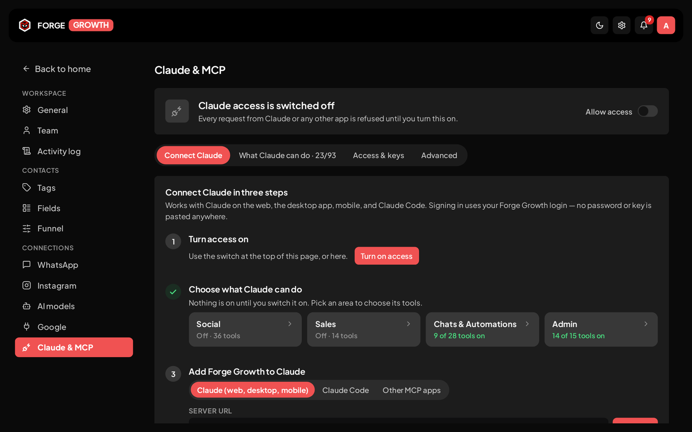

---

## Quick start

### Already on a server with Docker? One command.

```bash
bash -c "$(curl -fsSL https://raw.githubusercontent.com/Forgemind-git/ForgeGrowth-OSS/v3.1.1/scripts/install.sh)" -- \
  --version v3.1.1 --domain crm.example.com --yes
```

Swap `crm.example.com` for your domain. That single command is the entire install: it pulls the
images, generates every secret, obtains a Let's Encrypt certificate, starts the stack, **fetches the
public URL to prove it actually answers**, and prints the admin password once. Nothing is cloned,
nothing is compiled, and `--yes` means it asks nothing.

Two things to have ready first:

- the domain's **DNS already pointing at this machine** — Let's Encrypt validates over port 80, so a
  domain that does not resolve here fails the certificate, not the install;
- **ports 80 and 443 free.** Already running a reverse proxy that owns them? Use
  `--url https://crm.example.com --port 8080` instead and point your proxy at 8080 —
  [`docs/reverse-proxy.md`](./docs/reverse-proxy.md).

No domain yet? Drop `--domain` and it comes up on `http://<this machine's address>:8080`, which is
fine for a look around but not for WhatsApp — Meta requires HTTPS for webhooks.

When it finishes, connect a channel — **[a WhatsApp number](./docs/whatsapp.md)**, **[an Instagram
account](./docs/social-section.md)**, or both.

### Rather have Claude Code do it?

SSH into the server, start [Claude Code](https://claude.com/claude-code) with `claude`, and paste the
prompt below. Change the first line to your domain. Claude checks the server first and picks the
right route — its own HTTPS, behind a proxy you already run, or no domain yet — then runs the same
installer and proves the result before calling it done.

```text
Install Forge Growth (https://github.com/Forgemind-git/ForgeGrowth-OSS) on this server, version v3.1.1.

My domain: crm.example.com    <- replace with yours, or write "no domain yet"

Read docs/install.md and docs/reverse-proxy.md at the v3.1.1 tag before you start. Then:

1. Prerequisites. `docker compose version` must work. If Docker or the Compose v2 plugin is
   missing, tell me and install it from docs.docker.com. Check there are 3 GB of free disk.

2. Pick the route. Find this server's public IP, check whether my domain's A record resolves to
   it, and check whether ports 80 and 443 are free (`ss -ltnp`).
   - Domain resolves here and 80/443 are free: use `--domain <my domain>`.
   - 80/443 are held by a reverse proxy already on this server (Traefik, nginx, Caddy, another
     app): do NOT stop or reconfigure it globally. Use `--url https://<my domain> --port <a free
     port>`, then route only my domain to that port in the existing proxy, as docs/reverse-proxy.md
     describes. Put any extra compose file in COMPOSE_FILE inside the install's .env, never in an
     exported shell variable.
   - The domain does not resolve here yet: stop and tell me which DNS record to create.
   - No domain: use `--url http://<public IP>:8080`, and remind me WhatsApp and Instagram need
     HTTPS later.
   Tell me which route you chose and why before running anything.

3. Install, from my home directory, with the pinned one-liner:
   bash -c "$(curl -fsSL https://raw.githubusercontent.com/Forgemind-git/ForgeGrowth-OSS/v3.1.1/scripts/install.sh)" -- --version v3.1.1 <flags from step 2> --yes

4. Verify the outcome, not the steps:
   curl -s -o /dev/null -w '%{http_code}\n' https://<my domain>/       -> must print 200
   curl -s https://<my domain>/api/auth/me                             -> must print {"error":"Unauthorized"}
   If the installer printed any "!" warning or either check fails, read
   `docker compose logs caddy` / `docker compose logs backend` in the install directory and fix the
   cause before telling me it is done.

5. Report: the URL, the admin email, and the admin password (from BOOTSTRAP_ADMIN_PASSWORD in
   the install's .env), and tell me to store FORGECRM_ENCRYPTION_KEY, SOCIAL_ENCRYPTION_KEY and
   POSTGRES_PASSWORD from .env somewhere off this server.

Rules: never edit or regenerate the secrets in .env; never run `docker compose down -v`; don't stop,
restart or change other containers or sites on this server; start and stop Forge Growth only with
./up.sh and ./down.sh from the install directory.

When it is running, walk me through connecting WhatsApp (docs/whatsapp.md) and/or Instagram
(docs/social-section.md).
```

---

The rest of this section is the same install, spelled out — for laptops, for Windows, and for handing
a zip to someone who will not paste a command from the internet.

Three steps. **Step 1 differs by platform; steps 2 and 3 are identical everywhere.**

Nothing is cloned and nothing is compiled — the installer pulls published images.

### Step 1 — Get Docker, and a shell to run it from

<details>
<summary><b>🐧 Linux</b></summary>

1. Install Docker Engine with the Compose v2 plugin —
   [docs.docker.com/engine/install](https://docs.docker.com/engine/install/).
2. Let your user reach Docker without `sudo`, then **log out and back in** for it to take effect:

   ```bash
   sudo usermod -aG docker $USER
   ```

3. Use any terminal.

</details>

<details>
<summary><b>🍎 macOS</b></summary>

1. Install **[Docker Desktop](https://docs.docker.com/desktop/install/mac-install/)** — or OrbStack
   or Colima, both of which work.
2. Start it, and wait for the whale icon to stop animating.
3. Use **Terminal** (or iTerm).

**Apple Silicon and Intel both run natively** — the images carry `linux/arm64` and `linux/amd64`, so
nothing is emulated.

</details>

<details>
<summary><b>🪟 Windows</b></summary>

The installer is a shell script, so it runs **inside WSL2** — not in PowerShell.

1. In **PowerShell as Administrator**, then reboot:

   ```powershell
   wsl --install
   ```

2. Install **[Docker Desktop](https://docs.docker.com/desktop/install/windows-install/)**, then turn
   on *Settings → Resources → WSL integration* for your distro.
3. Open the **Ubuntu** terminal from the Start menu. **Run everything from here**, and install into
   your Linux home (`~`) rather than `/mnt/c/...` — the Windows drive is dramatically slower.

Git Bash also works if you already have it. There is no PowerShell or `.bat` installer.

</details>

**Check it worked** — this must print a version, on every platform:

```bash
docker compose version
```

### Step 2 — Get Forge Growth and install it

Two ways in, same result. Pick either.

#### Option A — download the zip

Everything in one file, with a folder for each operating system.

1. Download **[`forge-growth-v3.1.1.zip`](https://github.com/Forgemind-git/ForgeGrowth-OSS/raw/main/dist/forge-growth-v3.1.1.zip)**
   (~145 KB). It is in this repository under [`dist/`](./dist), and also attached to the
   [releases page](https://github.com/Forgemind-git/ForgeGrowth-OSS/releases/latest) — two hosts, so
   one of them being down or rate-limiting you is not the end of the install.
2. Unzip it and open the folder for your OS — `linux/`, `macos/` or `windows/`. Each one is
   complete on its own; ignore the other two.
3. In your terminal, `cd` into that folder and run:

   ```bash
   chmod +x *.sh
   ./install.sh
   ```

Each folder has a `START-HERE.md` with the same steps, so the person you hand it to does not need
this page. The bundle is pinned to its own version — re-running `./install.sh` later upgrades within
that pin rather than jumping to the newest build.

#### Option B — one command

```bash
bash -c "$(curl -fsSL https://raw.githubusercontent.com/Forgemind-git/ForgeGrowth-OSS/main/scripts/install.sh)"
```

**On a server with a real domain**, pinned to a release and asking nothing at all:

```bash
bash -c "$(curl -fsSL https://raw.githubusercontent.com/Forgemind-git/ForgeGrowth-OSS/v3.1.1/scripts/install.sh)" -- \
  --version v3.1.1 --domain crm.example.com
```

---

Either way, the installer asks one question — the address people will use — generates every secret,
and **prints the admin password once**.

Give it `--domain crm.example.com` and it obtains a Let's Encrypt certificate on the way up and
verifies it actually works before reporting success. Point the domain's DNS at the machine first,
and leave ports 80 and 443 free.

> **You still need the internet the first time.** The zip holds the install files, not the
> application images — those are about 350 MB and are pulled on the first run.

### Step 3 — Sign in, then connect WhatsApp or Instagram

Open the URL the installer printed and sign in with the credentials it showed. Lost the password?

```bash
cd forge-growth
grep '^BOOTSTRAP_ADMIN_PASSWORD=' .env
```

Then connect **[a WhatsApp number](./docs/whatsapp.md)** and/or **[an Instagram account](./docs/social-section.md)**.

### Afterwards

From the install directory:

```bash
./up.sh          # start — and verify the public URL really answers
./down.sh        # stop, keeping the data
./install.sh     # upgrade: re-fetch, pull, restart
```

> **Building from source instead?** `git clone`, then `./scripts/install.sh`. You need 2 GB of RAM
> for the frontend build; the published images above skip that peak entirely.

Full detail — every install route, HTTPS, reverse proxies, running several installs on one machine —
is in **[`docs/install.md`](./docs/install.md)**.

---

## Requirements

| | |
|---|---|
| **Docker** | with the Compose v2 plugin — `docker compose version` must work |
| **OS** | Linux, macOS, or Windows via WSL2 — see [step 1](#step-1--get-docker-and-a-shell-to-run-it-from) |
| **RAM** | 2 GB to build; less if you run the published images |
| **Disk** | ~3 GB |

Nothing else. No Node, Postgres, Redis or MinIO on the host — it all runs in containers.


---

## Documentation

| | |
|---|---|
| **[Installing](./docs/install.md)** | Every route, platform notes, HTTPS, reverse proxies, backups |
| **[Connecting WhatsApp](./docs/whatsapp.md)** | Meta setup, the webhook, and the ngrok loop for a laptop |
| **[Connecting Instagram](./docs/social-section.md)** | The Meta app, Instagram login, webhooks and the privacy-policy URL |
| **[Features](./docs/features.md)** | The full catalogue and the reasoning behind it |
| **[Architecture](./docs/architecture.md)** | Stack, repo layout, invariants, development workflow |
| **[Reverse proxies](./docs/reverse-proxy.md)** | Traefik and nginx overlays, and the 404-while-healthy trap |
| **[Deploying](./DEPLOY.md)** | Onto a host you already run |
| **[Claude plugin](./forge-growth-plugin/README.md)** · **[Local MCP server](./mcp-server/README.md)** | Connecting Claude |
| **[Changelog](./CHANGELOG.md)** · **[Contributing](./CONTRIBUTING.md)** · **[Security](./SECURITY.md)** | |

---

## Architecture

| Layer | Technology |
|---|---|
| Database | PostgreSQL 16, raw SQL via `pg` — no ORM |
| Backend | Node.js 20, Express 4 |
| Queues | BullMQ on Redis — sends, media downloads, agent runs |
| Frontend | React 18 + Vite, inline styles |
| Auth | JWT in httpOnly cookies |
| Object storage | MinIO |

Diagram, invariants and the development workflow: **[`docs/architecture.md`](./docs/architecture.md)**.

---

## Security

- Every stored third-party credential — Meta access tokens, Google OAuth tokens, per-account webhook
  verify tokens, LLM API keys — is **encrypted at rest with AES-256-GCM**.
- MCP API keys are stored as SHA-256 hashes; the plaintext is shown once, at creation.
- **There is no default password.** The first admin's comes from `BOOTSTRAP_ADMIN_PASSWORD`, or is
  generated and printed once to the backend log.
- Webhook verify tokens are compared in constant time.
- All SQL is parameterised — no string interpolation, no ORM.
- helmet, plus a 600 req/min per-user rate limit.
- Only the web frontend publishes a host port. Postgres, Redis and MinIO stay on the internal Docker
  network.

> **Back up `.env` with your database — they are a pair.** `FORGECRM_ENCRYPTION_KEY` is the only thing
> that decrypts your stored credentials, and `POSTGRES_PASSWORD` is applied only when Postgres first
> creates its data directory. See [backups](./docs/install.md#backups--what-you-must-keep).

**Found a vulnerability?** Report it privately to <forgemind.business@gmail.com> rather than opening a
public issue — [`SECURITY.md`](./SECURITY.md) has the scope and what to expect.

---

## Want it customised?

Need a feature, an integration or a setup built for your own business? The Forgemind team who built
Forge Growth can do it for you.

| | |
|---|---|
| **WhatsApp** | [+91 93422 45724](https://wa.me/919342245724?text=Hi%20Forgemind%21%20I%27m%20using%20Forge%20Growth%20and%20I%27d%20like%20to%20customise%20it%20for%20my%20business.%20Can%20we%20talk%3F) — opens a chat with a message ready to send |
| **Email** | [contact@forgemind.in](mailto:contact@forgemind.in?subject=Customising%20Forge%20Growth&body=Hi%20Forgemind%20team%2C%0A%0AI%27m%20using%20the%20open-source%20Forge%20Growth%20and%20I%27d%20like%20to%20customise%20it%20for%20my%20business.%0A%0AWhat%20I%27m%20looking%20for%3A%0A%0A%0AThanks%2C%0A) |

The same details are one click away inside the app: the **Want it customised?** card above the
sidebar's Collapse control, or the ✦ button beside your avatar in the top bar.

---

## Contributing

Issues and pull requests are welcome. Keep changes tightly scoped, match the conventions of the file
you are editing, and don't restyle adjacent code in the same diff. There is deliberately no formatter
config: the diff should be the change.

[`CONTRIBUTING.md`](./CONTRIBUTING.md) has the rest — how to get a development stack running, the
checks CI will run on your branch, and the two rules that are easiest to get half-right. Everyone
taking part follows the [Code of Conduct](./CODE_OF_CONDUCT.md). The people who built this are in
[`AUTHORS.md`](./AUTHORS.md).

---

## License

**MIT** — see [`LICENSE`](./LICENSE).

Use it, modify it, self-host it, sell it, build a product on it. Keep the copyright notice; that is
the only condition. No copyleft, no network clause, no obligation to publish your changes.

> "Forge Growth" and the Forgemind logo are the project's marks. The licence covers the code, not the
> branding — rename a fork that you distribute.
